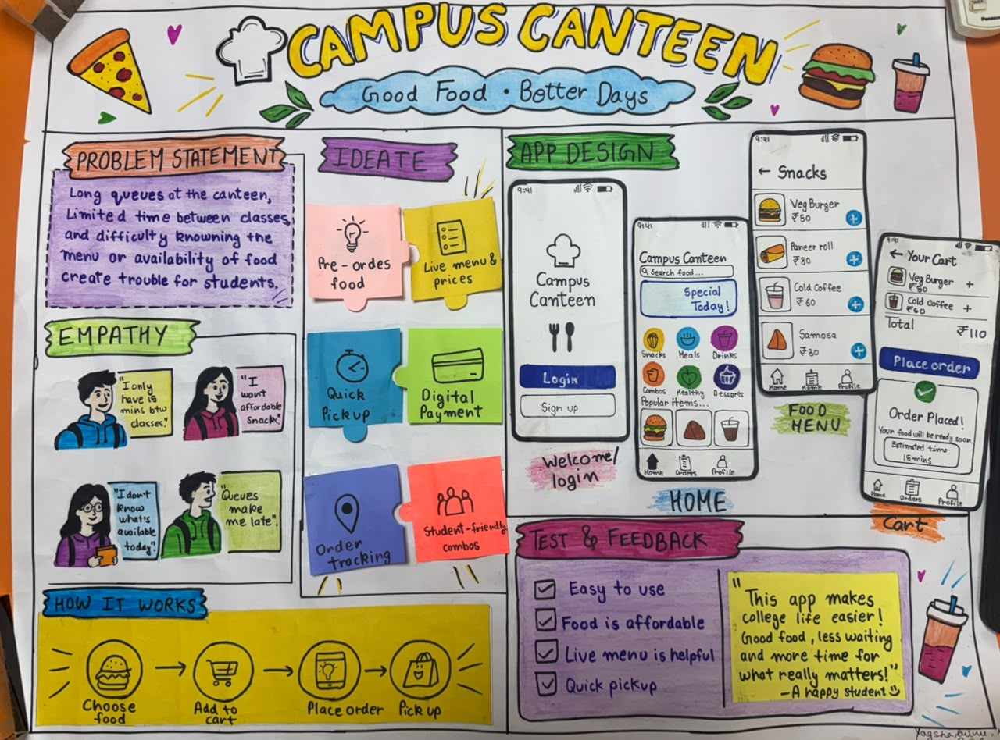

# Campus Canteen

**Good Food • Better Days**

Campus Canteen is a student-focused canteen ordering app concept designed to reduce waiting time, make food availability and pricing easy to check, and simplify ordering between classes.

## Project Overview

Long queues, limited time between classes, and uncertainty about the menu or food availability can make getting a meal difficult for students. Campus Canteen addresses these problems with a simple digital ordering experience.

## Design & Project Chart

The chart below presents the problem statement, student empathy insights, proposed ideas, app screens, ordering workflow, and initial testing criteria.

## Problem Statement

Students face:
- Long queues at the campus canteen.
- Limited time between classes.
- Difficulty knowing the menu, prices, and food availability in advance.

## Understanding Student Needs

The design considers common student concerns:
- Not having enough time to wait in a queue.
- Wanting affordable snacks and meals.
- Not knowing what food is available that day.
- Getting delayed when queues are long.

## Proposed Solution

Campus Canteen brings the canteen ordering process to a mobile-friendly interface.

Key ideas:
- **Pre-order food:** Place an order before reaching the canteen.
- **Live menu & prices:** View available items and their prices.
- **Quick pickup:** Reduce time spent waiting at the counter.
- **Digital payment:** Pay through the app.
- **Order tracking:** Follow the order status.
- **Student-friendly combos:** Make affordable meal options easier to find.

## App Flow

1. Open Campus Canteen.
2. Sign up or log in.
3. Browse the menu, categories, and today's specials.
4. Add food items to the cart.
5. Review the cart and place the order.
6. Collect the order when it is ready.

## Main Screens

The concept includes the following screens:
- Welcome / Login
- Home and food categories
- Menu and item listing
- Cart
- Order confirmation and pickup status

## Initial Testing & Feedback Criteria

The design can be evaluated against these criteria:
- Ease of use
- Affordability of food
- Helpfulness of the live menu
- Convenience and speed of pickup

## Expected Benefits

- Less time spent standing in queues.
- Better visibility of menu items and prices.
- A more convenient ordering experience.
- More time for students between classes.

## Project Status

This repository currently documents the **Campus Canteen concept and its initial design chart**. The chart is a design/prototype concept, not a claim that a production application is already deployed.

## Repository Layout

- `apps/student_app` – Flutter student app (phone OTP login).
- `apps/web` – staff and admin web console (React + Vite, email/password login). See `apps/web/README.md`.
- `server` – Fastify + MySQL API and Socket.IO. See `server/README.md`.
- `deploy` – Caddy, PM2 and backup config for the Mac mini.

## Contributing

Suggestions and improvements are welcome. You can open an issue or submit a pull request with your ideas.

---

*Campus Canteen — Good Food • Better Days.*
